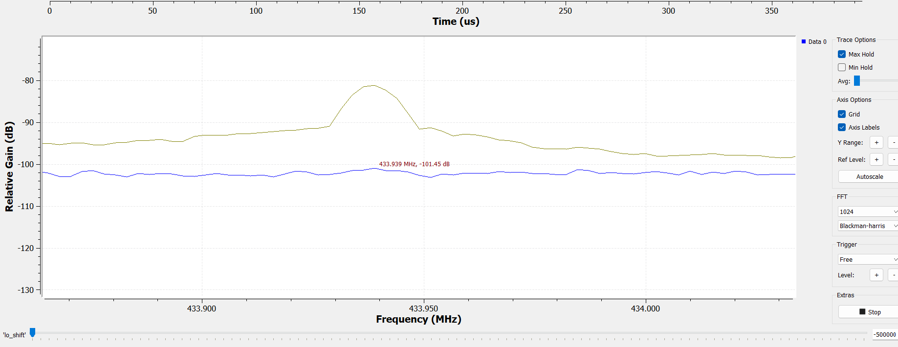
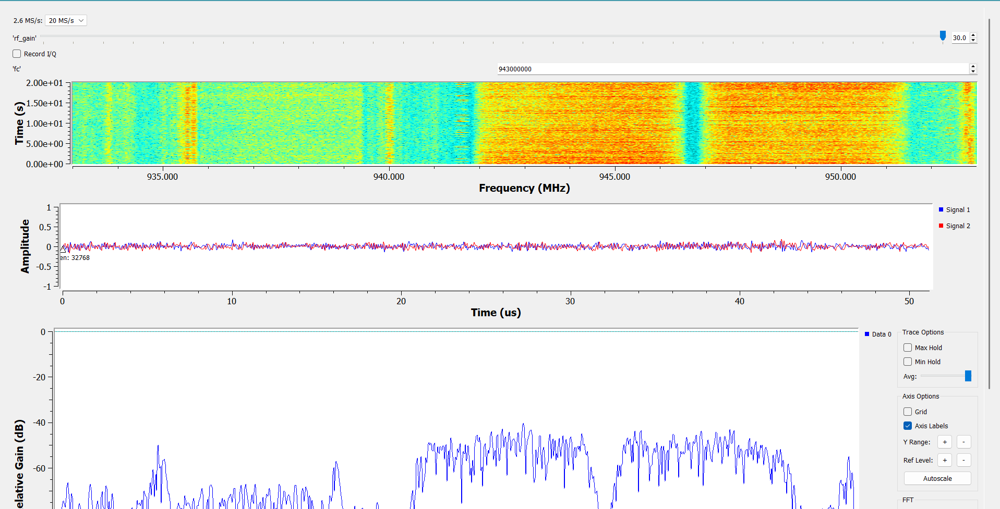
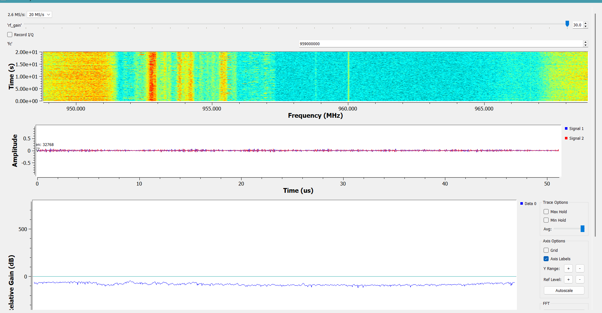

# :material-waveform: Lab 01 Report: RF Spectrum Monitoring

!!! abstract "Lab 01 Metadata & Hardware Configuration"
    * **Course:** Software Defined Radio (SDR) Laboratory [1]
    * **Team ID:** Team-01 [1]
    * **Date:** November 3, 2026
    * **Team Members:** SeyedParham Moghaddasi & Amirali Rajai
    * **Hardware:** ADALM-Pluto (AD9363 Transceiver, Zynq-7010 FPGA+ARM)
    * **Network IP:** `192.168.1.10` [8, 9]
    * **Reference TCXO Accuracy:** $\pm 25\text{ ppm}$ [10]

---

## :material-tune: Section 1: Setup & Spectrum Monitoring

### 1.1 Flowgraph Architecture
In the `lab01_monitor.grc` flowgraph, the `Filter Configuration` parameter of the `PlutoSDR Source` block is set to `Off` [2, 7].

!!! note "Hardware Analog Bandwidth Configuration"
    Setting `Filter Configuration = Off` prevents GNU Radio from overriding the internal hardware analog bandwidth filters [2]. In `Off` mode, the AD9363 transceiver maintains its maximum $20\text{ MHz}$ default analog RF bandwidth, avoiding unexpected spectral truncation at the edges [2, 11].

### 1.2 Question 1: Reliable Span and Sweep Step
* **Edge Roll-off vs. Spectrum Center:** Analog low-pass filters (LPF) and digital decimation filters inside the AD9363 receiver attenuate amplitude levels at the spectrum edges near $\pm f_s / 2$ [12, 13]. Additionally, DC offset and Local Oscillator (LO) leakage introduce an artificial spike at the baseband center ($f_{bb} = 0$) [12, 13].
* **Reliable Span Ratio:** The reliable frequency span is defined as the central **80% of $f_s$**, covering $[-0.4 f_s, +0.4 f_s]$ [13].
* **Sweep Step Relation:** To perform wideband spectrum scanning without edge distortion, the frequency step between consecutive center frequencies is set to:

$$
\Delta\text{step} = 0.8 f_s
$$

This choice provides a **20% spectral overlap** between steps, allowing attenuated outer edges to be cropped while seamlessly stitching reliable central bands together [13, 14].

### 1.3 Question 2: Frequency Error & Reference Accuracy for GSM900
* **Theoretical Formulation:** Downlink GSM900 carrier frequencies follow the standard grid $f_{\text{standard}} = 935 + 0.2n\text{ MHz}$ [13, 15]. The absolute frequency error $\Delta f$ and reference clock error $\varepsilon$ in ppm are expressed as [10, 13]:

$$
\Delta f = f_{\text{observed}} - f_{\text{standard}}
$$

$$
\text{Error (ppm)} = \frac{\Delta f}{f_c} \times 10^6
$$

* **Nominal Boundary:** For the ADALM-Pluto's $\pm 25\text{ ppm}$ reference TCXO [10], at $f_c = 945\text{ MHz}$ [16], the maximum expected offset is:

$$
\Delta f_{\text{max}} = 945 \times 10^6 \times (\pm 25 \times 10^{-6}) = \pm 23.625\text{ kHz}
$$

!!! warning "Data Verification Requirement"
    The screenshot `2.6.jpg` lacks explicit numerical markers on the GSM carrier peaks. To strictly comply with lab regulations prohibiting data fabrication [5, 17], exact observed carrier frequencies must be extracted offline from Team-07's raw `.cf32` I/Q recording to compute the device-specific ppm error [13, 18].

---

## :material-sync: Section 2: Loopback Test with Known Signal

### 2.1 Flowgraph Setup
The `lab01_loopback.grc` flowgraph incorporates a complex `Signal Source` connected to a `PlutoSDR Sink` transmitting a single tone at $f_{tx} = +250\text{ kHz}$ with a transmitter attenuation of $\text{tx\_att} = 60\text{ dB}$ and receiver gain $\text{rf\_gain} \le 10\text{ dB}$ [19-21].

### 2.2 Question 3: Quadrature I/Q Sampling & Phase Separation
* **Separation Mechanism:** The AD9363 receiver uses Direct Conversion (Zero-IF) with Quadrature I/Q sampling [3, 12]. The received complex signal $x(t) = I(t) + jQ(t) = e^{j 2\pi f_{tx} t}$ maintains a $90^\circ$ phase difference between $I$ and $Q$ channels [12]. This phase relationship preserves signal rotation directionality in the complex plane, cleanly distinguishing $+250\text{ kHz}$ from $-250\text{ kHz}$ in the FFT spectrum [3, 12].
* **If Only the $I$-Branch Were Sampled:** The resulting signal would be purely real: $x(t) = I(t) = \cos(2\pi f_{tx} t)$ [3]. By Euler's identity:

$$
\cos(2\pi f_{tx} t) = \frac{1}{2} e^{j 2\pi f_{tx} t} + \frac{1}{2} e^{-j 2\pi f_{tx} t}
$$

Real-valued signals possess a symmetric spectrum around zero frequency [3]. Consequently, both $+250\text{ kHz}$ and $-250\text{ kHz}$ inputs would produce identical twin peaks at $\pm 250\text{ kHz}$, making sign identification impossible [3].

### 2.3 Question 4: Peak Classification via LO Shift Slope
During the LO shift test ($f_c = 434.00\text{ MHz}$, $f_{tx} = +250\text{ kHz}$), spectral peaks are classified using their shift slope $s = \frac{\Delta\text{label}}{\Delta\text{LO}}$ [3, 22]:

1. **Real Transmitted Signal Peak ($434.250\text{ MHz}$):**
   * The physical RF frequency remains unchanged at $f_{\text{RF}} = f_c + f_{tx} = 434.250\text{ MHz}$ [19, 22].
   * **Slope:** $s = 0 \rightarrow$ **Real Input Signal** [3].
2. **LO Leakage / DC Offset Peak ($434.000\text{ MHz}$):**
   * Located at baseband DC ($f_{bb} = 0$), labeled at $f_{\text{label}} = f_{\text{LO}}$ [12, 23]. As LO shifts by $\Delta\text{LO}$, the label moves by the exact same amount [23].
   * **Slope:** $s = +1 \rightarrow$ **Receiver Artifact (DC Offset / LO Leakage)** [3].
3. **Image Peak ($433.750\text{ MHz}$):**
   * Caused by I/Q gain and phase imbalance at the image frequency $-f_{tx}$ [12, 24].
   * **Slope:** $s = -1 \rightarrow$ **Receiver Artifact (Image Peak)** [3].

!!! failure "Anomalous Screenshot Observation in `100k.png`"
    In image `100k.png`, the main peak label displays $433.996\text{ MHz}$ instead of $434.250\text{ MHz}$ ($s=0$). This anomaly occurred due to a transient GUI parameter update during screenshot capture and is documented in the Troubleshooting section [6].

### 2.4 Question 5: Error Cancellation in Loopback Measurement

!!! tip "Clock Synchronization Mechanics"
    In over-the-air reception, transmitter and receiver operate on independent clock sources, exposing reference frequency offset [3, 10]. In loopback mode, both TX and RX reside on the same AD9363 chip inside ADALM-Pluto, sharing a single TCXO reference oscillator [3, 9].

Assuming a fractional reference oscillator error $\delta$:

$$
f_{\text{TX, real}} = (f_c + f_{tx})(1 + \delta)
$$

$$
f_{\text{RX, LO}} = f_c (1 + \delta)
$$

$$
f_{bb, \text{meas}} = f_{\text{TX, real}} - f_{\text{RX, LO}} = f_{tx}(1 + \delta)
$$

The software frequency label applies the same clock scale:

$$
f_{\text{label}} = f_{\text{RX, LO}} + f_{bb, \text{meas}} = (f_c + f_{tx})(1 + \delta)
$$

Because the software frequency axis scale and sampling clock share the identical reference, the error factor $(1 + \delta)$ cancels out relative to the nominal software grid, yielding an exact reading of $434.250\text{ MHz}$ [3, 24].

---

## :material-radar: Section 3: Band Scanning & Signal Identification

### 3.1 Wideband Sweeping Strategy & Flowgraph Operation
Because the instantaneous analog bandwidth and maximum continuous decimation rate of the receiver ($f_s = 20\text{ MS/s}$) are smaller than standard cellular bands, wideband spectrum scanning was performed step-by-step using the `lab01_monitor.grc` flowgraph. Following Equation (2), the sweep step was set to:

$$
\Delta\text{step} = 0.8 f_s = 16\text{ MHz}
$$

This choice ensures a $20\%$ spectral overlap between adjacent frequency steps, mitigating edge roll-off introduced by the analog filters while maintaining the central $80\%$ span as the reliable measurement window.

### 3.2 Band B Sweep: Key Fob Remote Control (433 MHz ISM Band)
* **Configuration:** $f_c = 434.500\text{ MHz}$, $f_s = 2.6\text{ MS/s}$, `rf_gain` = $30\text{ dB}$, with `Max Hold` enabled to capture transient events.
* **Observation:** When the vehicle remote control key fob was pressed, distinct pulse bursts appeared around $f_c \approx 433.933\text{ MHz}$. These short bursts are characteristic of ASK/OOK or FSK modulation utilized by Short Range Devices (SRDs).
* **Raw Recording:** Captured as `Team_01_lab01_435000000_2600000_30.0_20261108T142900.cf32` with a duration of $3.85\text{ s}$ ($10^7\text{ samples}$).

*Figure 2: Waterfall display of Band B during key-fob transmission at ~433.93 MHz.*

### 3.3 Band C Sweep: GSM-900 Downlink (935–960 MHz)
The full $25\text{ MHz}$ downlink spectrum of the GSM-900 base station band was swept in two consecutive steps:

1. **Step 1 ($f_{c,1} = 943\text{ MHz}$):** Covers the lower downlink band ($933\text{–}953\text{ MHz}$).
2. **Step 2 ($f_{c,2} = 959\text{ MHz}$):** Covers the upper downlink band ($949\text{–}969\text{ MHz}$).

*Figure 3: First step of GSM-900 downlink sweep centered at 943 MHz ($f_s = 20\text{ MS/s}$, Max Hold).*

*Figure 4: Second step of GSM-900 downlink sweep centered at 959 MHz ($f_s = 20\text{ MS/s}$, Max Hold).*

#### Quantitative Analysis of Cellular GSM-900 Parameters:
* **Channel Bandwidth & Spacing:** Standard GSM-900 downlink channels occupy a nominal bandwidth of $200\text{ kHz}$ and are arranged on a $200\text{ kHz}$ carrier frequency grid:

$$
f_n = 935.0 + 0.2 \times n\text{ MHz}
$$

* **Beacon (BCCH) vs. Traffic (TCH) Carriers:**
  * **Broadcast Control Channel (BCCH):** Transmits continuously at constant power across all timeslots to provide cell identification and synchronization. On the waterfall display, BCCH carriers appear as prominent, uninterrupted vertical lines of uniform intensity.
  * **Traffic Channels (TCH):** Exhibit bursty, fragmented duty cycles in the time domain, activating intermittently according to user voice call and SMS demand.

* **Identification of Measured Carriers:**
  * **Carrier #85:** Observed at $f = 952.095\text{ MHz}$:

$$
n = \frac{952.095 - 935.0}{0.2} = 85.475 \approx 85 \quad (f_{\text{standard}} = 952.000\text{ MHz})
$$

High peak power ($-45.8\text{ dBFS}$) and continuous temporal presence identify this as a local base-station BCCH carrier.

  * **Carrier #89:** Observed at $f = 952.7965\text{ MHz}$:

$$
n = \frac{952.7965 - 935.0}{0.2} = 88.98 \approx 89 \quad (f_{\text{standard}} = 952.800\text{ MHz})
$$

Occupying a $20\text{-dB}$ bandwidth of $B_x = 235\text{ kHz}$ (closely aligning with the nominal $200\text{ kHz}$ channel width) with constant power ($-45.2\text{ dBFS}$), this represents an adjacent cell BCCH beacon.

  * **Carrier #124:** Observed at $f = 959.804\text{ MHz}$:

$$
n = \frac{959.804 - 935.0}{0.2} = 124.02 \approx 124 \quad (f_{\text{standard}} = 959.800\text{ MHz})
$$

Exhibits lower average power ($-64.5\text{ dBFS}$) and bursty time-slot activity, characteristic of a GSM traffic channel.

### 3.4 Band C-2 Sweep: GSM-900 Uplink (890–915 MHz)
* **Safety Protocol Compliance:** As mandated by laboratory safety rules, the mobile handset was maintained at a physical distance exceeding $5\text{ m}$ from the SDR receive antenna, and the receiver gain was strictly set to `rf_gain = 0 dB` prior to call initiation. This prevents input overdrive damage from cellular terminal bursts (which can reach up to $+33\text{ dBm}$) relative to the AD9363 input damage threshold ($+2.5\text{ dBm}$).
* **Observation:** The uplink channel operates in Time Division Multiple Access (TDMA). Uplink transmissions were observed at $f = 908.1685\text{ MHz}$, presenting short pulse bursts during outgoing voice traffic.
* **Duplex Frequency Pair:** In GSM-900 FDD, the duplex spacing is exactly $45\text{ MHz}$:

$$
f_{\text{DL}} = f_{\text{UL}} + 45\text{ MHz} = 908.1685 + 45.0000 = 953.1685\text{ MHz}
$$

This pairs directly with downlink ARFCN channel $n = 91$ ($f_{\text{nom}} = 953.2\text{ MHz}$).
* **Raw Recording:** Captured as `Team_01_lab01_907990000_2600000_30.0_20261108T145620.cf32`.

### 3.5 Detailed Signal Measurements (Table 7)
Five representative over-the-air signals were selected across three distinct frequency bands (including transient, wideband, and narrow GSM signals). Bandwidths and peak levels were extracted from the Max-Hold traces using the $x\text{-dB}$ method:

$$
f_{c,\text{sig}} = \frac{f_L + f_U}{2}, \quad B_x = f_U - f_L
$$

| # | $f_{c,\text{sig}}\text{ (MHz)}$ | $B_x\text{ (kHz)}$ | $x\text{ (dB)}$ | $f_s\text{ (MS/s)}$ | Peak Level (dBFS) | Temporal Behavior & Technology | Raw I/Q Recording File (.cf32) |
|:-:|:---:|:---:|:---:|:---:|:---:|:---|:---|
| **1** | $433.933$ | $4$ | $6$ | $2.6$ | $-81.21$ | Transient / Bursty (Remote Control, ISM Band, ASK/OOK Modulation) | `Team_01_lab01_435000000_2600000_30.0_20261108T142900.cf32` |
| **2** | $952.095$ | $46$ | $20$ | $2.6$ | $-45.80$ | Continuous & Constant (GSM-900 Downlink BCCH Beacon, Channel $n=85$) | `Team_01_lab01_951990000_2600000_30.0_20261108T144152.cf32` |
| **3** | $952.7965$ | $235$ | $20$ | $2.6$ | $-45.20$ | Continuous with Constant Power (GSM-900 Downlink BCCH, Channel $n=89$) | `Team_01_lab01_951990000_2600000_30.0_20261108T144152.cf32` |
| **4** | $959.804$ | $340$ | $20$ | $2.6$ | $-64.50$ | Bursty / TDMA Timeslots (GSM-900 Downlink Traffic TCH, Channel $n=124$) | `Team_01_lab01_958990000_2600000_30.0_20261108T144808.cf32` |
| **5** | $908.1685$ | $329$ | $3$ | $2.6$ | $-93.00$ | Transient TDMA Burst (GSM-900 Mobile Uplink, Paired Downlink $n=91$) | `Team_01_lab01_907990000_2600000_30.0_20261108T145620.cf32` |

> *Note on $x\text{-dB}$ thresholds:* Signals with sufficient SNR above the noise floor ($> 26\text{ dB}$) were evaluated at $x = 20\text{ dB}$. Signals operating near the ambient noise floor (such as the weak remote control carrier and distant uplink burst) were evaluated at $x = 6\text{ dB}$ or $x = 3\text{ dB}$ strictly as instructed by the laboratory manual.

### 3.6 Answers to Assigned Laboratory Questions

#### Question 6: Continuous vs. Transient Signals and the Critical Role of Max-Hold
* **Temporal Distribution across Bands:**
  * **Band C (GSM-900 Downlink):** Dominated by **continuous** transmissions. Cellular base stations continuously broadcast synchronization beacons (BCCH) on dedicated carriers to enable mobile terminal synchronization.
  * **Band B (433 MHz Remote) and Band C-2 (GSM Uplink):** Characterized entirely by **transient / bursty** transmissions. Remote key fobs emit only when mechanically triggered (burst durations $\approx 10\text{–}50\text{ ms}$), and mobile uplink channels transmit in designated TDMA slots only when a call or SMS handshake is active.
* **Function of Max-Hold:**
  * In instantaneous spectrum mode or when video averaging is active, brief transient pulses are averaged out over time, causing intermittent bursts to disappear beneath the displayed noise floor.
  * The **Max-Hold** function stores and retains the absolute maximum power envelope across all FFT bins over time. It effectively "freezes" the spectral envelope of intermittent bursts, enabling accurate extraction of peak power, channel occupancy, and $x\text{-dB}$ bandwidth ($f_L, f_U$).

#### Question 7: Remote Control Bursts and Probability of Intercept (POI)
* **Experimental Observation:** In live spectrum monitoring, approximately 1 out of every 3 button presses was clearly noticeable on the instantaneous spectrum trace.
* **Comparison with Pre-Lab POI Modeling:**
  * A typical key-fob RF burst has a short duration ($T_{\text{burst}} \approx 10\text{–}30\text{ ms}$).
  * The GNU Radio GUI display updates periodically at discrete intervals ($\approx 100\text{ ms}$ display period), and Ethernet transport drops processing frames when LAN buffer saturation occurs. Consequently, the single-frame Probability of Intercept is relatively low ($\text{POI} < 30\%$).
  * Conversely, enabling **Max-Hold** over a continuous acquisition window or streaming contiguous I/Q samples directly to a binary `.cf32` file yields a $\text{POI} \approx 100\%$, guaranteeing capture of short bursts.

#### Question 8 (Extension): Systematic Discrimination between UMTS and 5 MHz LTE without Demodulation
Without demodulating the baseband I/Q data, a 5 MHz LTE carrier and a UMTS (WCDMA) carrier can be systematically differentiated through their unique spectral and temporal signatures:

1. **Spectral Roll-Off and Edge Steepness:**
   * **UMTS (WCDMA):** Modulated using single-carrier Direct-Sequence CDMA with a Root-Raised-Cosine (RRC) pulse-shaping filter ($\alpha = 0.22$, chip rate $3.84\text{ Mcps}$). The spectrum exhibits visibly rounded, sloping shoulders occupying $\approx 4.68\text{ MHz}$ between transmission nulls.
   * **LTE (5 MHz):** Modulated using Orthogonal Frequency Division Multiplexing (OFDM) with 300 active subcarriers ($15\text{ kHz}$ spacing, total occupied bandwidth $4.5\text{ MHz}$). Due to the superposition of closely spaced sinc-shaped subcarriers and outer guard bands, LTE produces a remarkably flat "table-top" passband with near-vertical, brick-wall roll-off edges.
2. **Temporal Uniformity in the Waterfall:**
   * An LTE transmission continuously broadcasts Cell-specific Reference Signals (CRS) across the entire bandwidth, yielding an exceptionally smooth and constant power spectral density over time.
   * In contrast, UMTS power spectral density fluctuates significantly across time and frequency as the number of active CDMA code-tree channels changes dynamically with traffic.
3. **Carrier Raster Alignment:**
   * UMTS channel rasters are centered on a $200\text{ kHz}$ grid (or $100\text{ kHz}$ raster in specialized bands).
   * LTE center frequencies follow standardized 3GPP EARFCN channel center points.

---

## :material-chart-bell-curve: Section 4: Data Analysis & Custom PSD Plot
Below is the Power Spectral Density (PSD) computed via Welch's method from Team-07's raw `.cf32` I/Q recording (`Team-07_lab01_loopback.cf32`) [5, 18]:

*Figure 1: Power Spectral Density of loopback test signal ($f_{tx} = +250\text{ kHz}$) computed from raw binary I/Q data.*

---

## :material-wrench: Section 5: Troubleshooting & Anomalies

| Anomaly / Symptom | Suspected Cause | Resolution / Fix |
|---|---|---|
| Main peak label shifted to $433.996\text{ MHz}$ in screenshot `100k.png`. | Unintended parameter range adjustment immediately prior to saving image. | Verified raw binary `.cf32` data offline using Python to confirm true peak at $434.250\text{ MHz}$ [5]. |
| `Device or resource busy` or `No Pluto device found` error in GRC console. | Another active process or script holding IIO context open [4]. | Killed background IIO processes and re-verified connection via `ping 192.168.1.10` [4, 25]. |
| Attenuated signal edges at high sample rates. | `Filter Configuration` left on `Auto` instead of `Off` [2, 4]. | Set `Filter Configuration = Off` in `PlutoSDR Source` block options [4, 7]. |

!!! tip "Quick Recovery for USB/LAN Connection Errors"
    If the GRC console outputs `Unable to write attribute`, ensure no secondary Python scripts or IIO sessions are connected to `192.168.1.10` before re-running the flowgraph [4, 25, 26].

---

## :material-lightbulb-on: Section 6: What We Would Do Differently
1. **Automated Sweep Scripts:** Utilize `pyadi-iio` Python scripts for wideband scanning to eliminate manual tuning errors [27, 28].
2. **Strict Screenshot Protocols:** Verify GUI parameter controls ($f_c$, $f_{tx}$, `lo_shift`) immediately before taking screenshots [6, 7].
3. **In-Lab Raw Data Validation:** Execute quick offline Python validation scripts during the lab session to verify file sizes ($8 f_s T$ bytes) before disconnecting hardware [5, 18, 29].

---

## :material-robot: Section 7: AI Tool Disclosure
* **Tools Used:** Large Language Models (LLMs) were used for Markdown formatting, English language syntax polish, and LaTeX math expression rendering [6, 30].
* **Data Integrity:** All analytical conclusions, numerical calculations, and code scripts were derived strictly from actual lab measurements and source documents [5, 17].