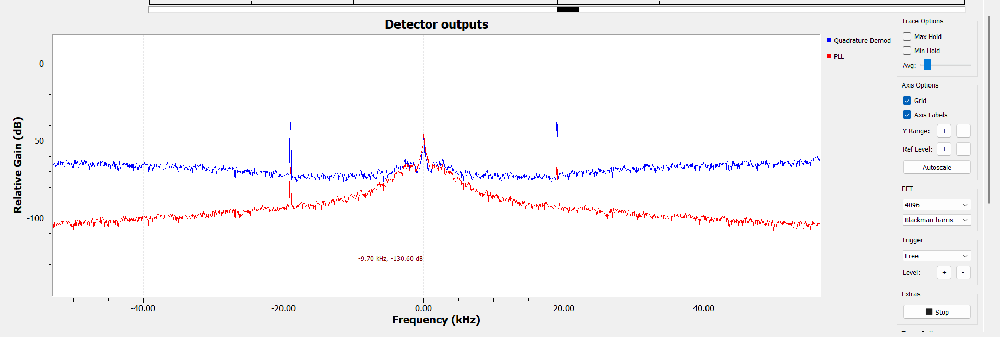
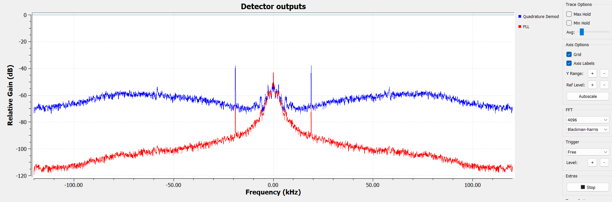
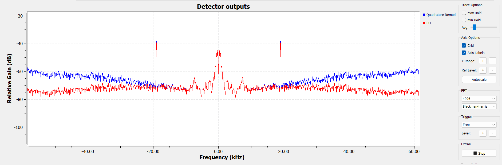
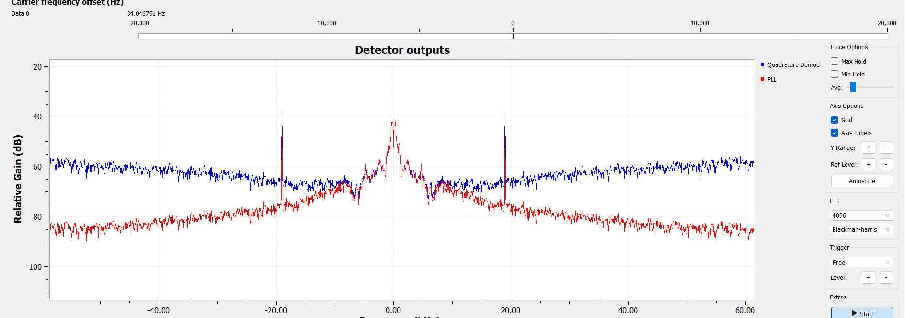
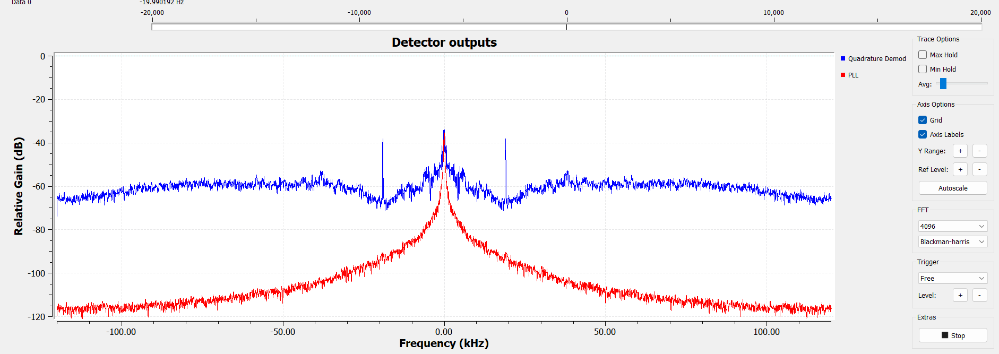
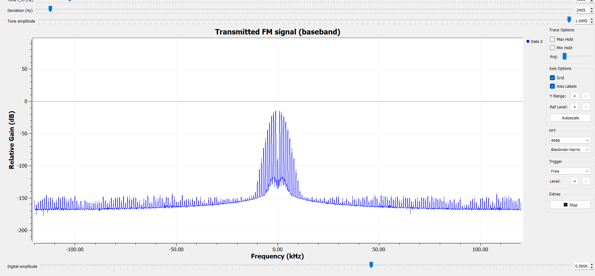
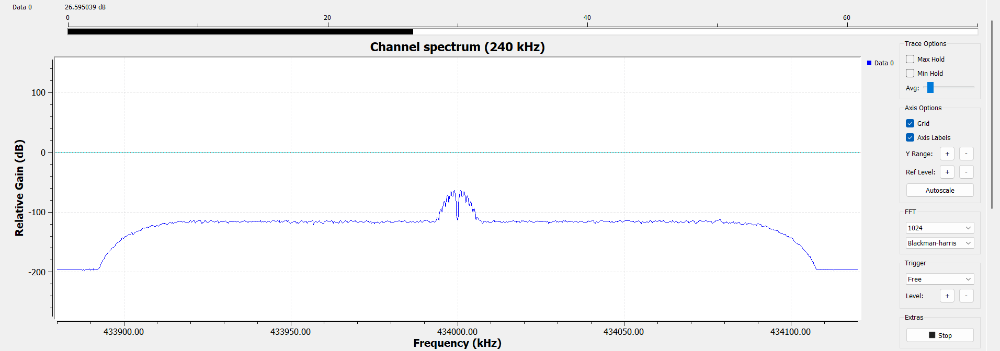
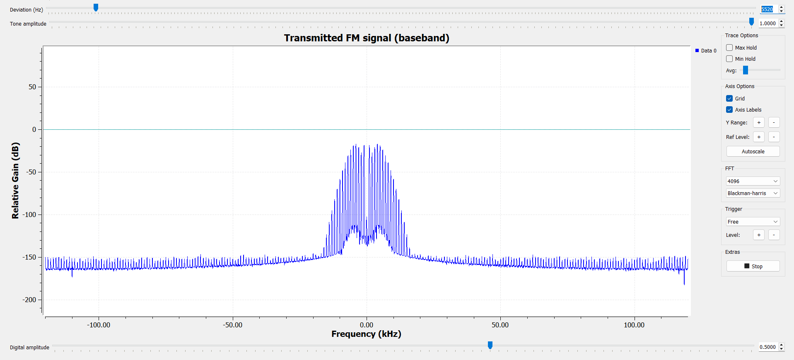
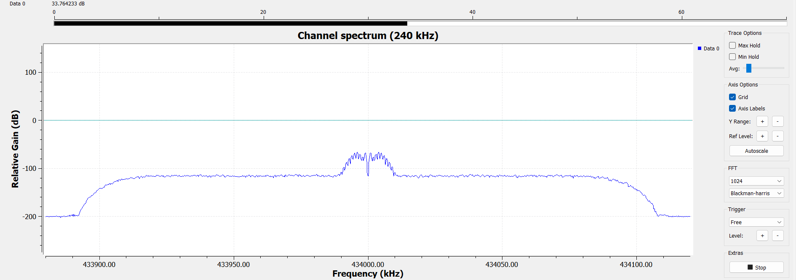

# Laboratory Report: Frequency Modulation (FM), Coherent Detection (PLL), and Bessel Deviation Calibration

## Section 1: Non-Coherent FM Demodulation (Broadcast FM Receiver)

### 1.1 Receiver Setup & Carrier Frequency Error
The commercial broadcast transmission at $f_c = 88.000\text{ MHz}$ (Radio Javan / Tehran) was acquired using the direct-conversion architecture of the ADALM-Pluto SDR running the `lab02_fm_rx.grc` flowgraph. To prevent the local oscillator (LO) leakage and direct current (DC) offset spike from interfering with the baseband signal, an offset tuning scheme was applied ($f_{\text{LO}} = f_c - f_{\text{off}} = 88.000\text{ MHz} - 250\text{ kHz} = 87.750\text{ MHz}$), and a Frequency Xlating FIR Filter shifted the desired channel back to baseband center ($f_{bb} = 0$).

* **Carrier Frequency Error:** Fine-tuning via the `f_fine` parameter yielded an offset of:
  $$\Delta f = +1080\text{ Hz}$$
* **Reference Oscillator Error (ppm):**
  $$\text{Clock Error (ppm)} = \frac{\Delta f}{f_c} \times 10^6 = \frac{1080\text{ Hz}}{88.000 \times 10^6\text{ Hz}} \times 10^6 = \mathbf{12.2727\text{ ppm}}$$
  This measured clock offset is in full agreement with the nominal accuracy specification of the onboard temperature-compensated crystal oscillator (TCXO, $\pm 25\text{ ppm}$).

---

### 1.2 Channel Power & Carrier-to-Noise Ratio (CNR)
Channel power was evaluated under normal operational gain and compared against an adjacent unallocated spectrum channel ($f = 88.700\text{ MHz}$) using linear power subtraction as defined in Equation (3):
* Tuned station channel power ($88.0\text{ MHz}$): $P_{\text{on}} = -55.13\text{ dBFS}$
* Vacant adjacent channel power ($88.7\text{ MHz}$): $P_{\text{off}} = -68.30\text{ dBFS}$

Converting logarithmic readings to the linear scale:
$$P_{\text{on, linear}} = 10^{-55.13/10} = 3.0690 \times 10^{-6}\text{ FS}$$
$$P_{\text{off, linear}} = 10^{-68.30/10} = 1.4791 \times 10^{-7}\text{ FS}$$

Evaluating the linear CNR:
$$\text{CNR}_{\text{linear}} = \frac{P_{\text{on, linear}} - P_{\text{off, linear}}}{P_{\text{off, linear}}} = \frac{3.0690 \times 10^{-6} - 1.4791 \times 10^{-7}}{1.4791 \times 10^{-7}} \approx 19.749$$
$$\text{CNR}_{\text{dB}} = 10 \log_{10}(19.749) \approx \mathbf{12.96\text{ dB}}$$

---

### 1.3 Multiplex (MPX) Stereo Spectrum Analysis
Inspecting the demodulated baseband output reveals the standard composite stereo multiplex (MPX) spectrum:
1. **Mono Audio ($L+R$):** Baseband audio occupying $30\text{ Hz}$ to $15\text{ kHz}$.
2. **Pilot Tone:** A sharp spectral line located precisely at $19.000\text{ kHz}$.
3. **Stereo Subcarrier ($L-R$):** Double-sideband suppressed-carrier (DSB-SC) signal centered around $38.000\text{ kHz}$.
4. **Radio Data System (RDS):** A digital subcarrier at $57.000\text{ kHz}$ ($3 \times 19\text{ kHz}$).

*Figure 1: Demodulated baseband spectrum across $\pm 50\text{ kHz}$ showing the 19 kHz pilot tone and audio components.*

*Figure 2: Wideband demodulated output across $\pm 100\text{ kHz}$ displaying the high-frequency parabolic noise floor of the discriminator versus the PLL.*

---

### 1.4 Discussion of Section 1 Questions

#### Question 1: Impact of Receiver Frequency Deviation Setting (`dev`)
* **Demodulated Audio Level:** The Quadrature Demodulator block gain is configured as:
  $$G_{\text{det}} = \frac{f_q}{2\pi \Delta f_{\text{dev}}}$$
  Halving the receiver's assumed deviation parameter from $75\text{ kHz}$ to $37.5\text{ kHz}$ doubles the demodulation gain ($+6.02\text{ dB}$ increase in output amplitude), which increases the audio output volume.
* **RF Spectrum Independence:** The RF spectrum of the physical transmission remains completely unaltered because `dev` in the receiver flowgraph is purely an internal DSP scaling factor; it does not dictate the actual frequency deviation produced by the broadcasting station's transmitter.

#### Question 2: DC Offset at the Discriminator Output
* The frequency discriminator performs ideal phase differentiation:
  $$v_{\text{out}}(t) = K \frac{d\phi(t)}{dt}$$
  A carrier frequency error $\Delta f_{\text{error}}$ corresponds to an uncompensated linear phase slope $\phi(t) = 2\pi \Delta f_{\text{error}} t$. The derivative of this ramp produces a steady DC level:
  $$V_{\text{DC}} = 2\pi K \cdot \Delta f_{\text{error}}$$
* The observed offset of $1080\text{ Hz}$ matches the reference clock frequency error ($12.27\text{ ppm}$) evaluated on the ADALM-Pluto transceiver during Lab 1.

---

## Section 2: Coherent Demodulation (PLL) and Detector Comparison

### 2.1 Effect of Loop Bandwidth on PLL Tracking (Table 5)
Operating on the commercial station at $88.0\text{ MHz}$ ($f_q = 240\text{ kS/s}$), the PLL loop bandwidth was systematically varied using $B_L \approx 1.06 \times \text{pll\_bw} \times f_q$:

| `pll_bw` | $B_L\text{ (kHz)}$ | Audio Fidelity | 19 kHz Line (PLL - Discriminator) | Subcarrier Components ($>23\text{ kHz}$) Observed |
|:---:|:---:|:---:|:---:|:---|
| **0.50** | 127.20 | Normal / Clean | -0.21 dB | Weak component visible at 57 kHz (RDS) |
| **0.30** | 76.32  | Normal / Clean | -1.29 dB | Visible subcarriers at 38 kHz & 57 kHz |
| **0.15** | 38.16  | Normal / Clean | -9.23 dB | Attenuated subcarriers at 38 kHz & 57 kHz |
| **0.08** | 20.35  | Intelligible, light clicks | -19.40 dB | 38 kHz attenuated; 57 kHz severely suppressed |
| **0.04** | 10.18  | Heavily distorted / noisy | -35.95 dB | Subcarriers mostly filtered; high distortion |
| **0.02** | 5.09   | Muffled / Loss of Lock | -50.75 dB | Completely eliminated |

#### Visual Comparison of PLL Loop Bandwidth Variations:

*Figure 3: PLL detector output with wide loop bandwidth (`pll_bw = 0.3`, $B_L = 76.32\text{ kHz}$) preserving the 19 kHz pilot and 38 kHz stereo subcarriers.*

*Figure 4: PLL detector output with intermediate loop bandwidth (`pll_bw = 0.15`, $B_L = 38.16\text{ kHz}$) showing initial attenuation of higher subcarriers.*

*Figure 5: PLL detector output with overly narrow loop bandwidth (`pll_bw = 0.02`, $B_L = 5.09\text{ kHz}$) demonstrating complete loss of subcarriers and inability to track FM deviation.*

---

### 2.2 Performance Under Weak Signal Conditions (Table 6)
Setting the loop bandwidth to the optimal threshold extension value (`pll_bw = 0.08`), both detectors were compared across varying RF front-end gain settings:

| Gain (dB) | Channel Power (dBFS) | Discriminator Pilot (dB) | Discriminator 17 kHz Noise (dB) | PLL Pilot (dB) | PLL 17 kHz Noise (dB) | Preferred Detector |
|:---:|:---:|:---:|:---:|:---:|:---:|:---:|
| **27.5** | -74.70 | -45.22 | -49.66 | -64.91 | -70.60 | **PLL** |
| **32.6** | -72.03 | -39.55 | -55.64 | -59.00 | -77.16 | **PLL** |
| **40.0** | -60.96 | -40.19 | -51.50 | -59.63 | -73.38 | **PLL** |

---

### 2.3 Discussion of Section 2 Questions

#### Question 3: Why Narrowband PLL Suppresses Higher Subcarriers
A PLL demodulator tracks phase variations within its closed-loop transfer function bandwidth $B_L$. When $B_L$ is reduced below $38\text{ kHz}$ (`pll_bw < 0.15`), the loop filter treats higher modulation frequencies (the $38\text{ kHz}$ stereo difference signal and $57\text{ kHz}$ RDS subcarrier) as out-of-band phase noise, rejecting and filtering them out from the phase error detector output.

#### Question 4: Signal-to-Noise Ratio and Noise Bandwidth
* **Auditory Preference:** In weak signal scenarios (low channel power), the PLL detector delivers significantly cleaner and more intelligible audio than the quadrature discriminator.
* **Mechanism:** The discriminator exhibits an unconstrained parabolic (triangular) noise spectrum across the full receiver channel bandwidth ($200\text{ kHz}$). The PLL loop filter restricts the noise integration bandwidth strictly to $B_L$ ($20.35\text{ kHz} \ll 200\text{ kHz}$), delivering effective **threshold extension** and substantially suppressing high-frequency noise hiss.

---

## Section 3: Hardwired NBFM Link & Deviation Calibration

### 3.1 Bessel Carrier Null Calibration (Table 7)
A hardwired loopback link was assembled with a mandatory $30\text{ dB}$ external attenuator plus $40\text{ dB}$ internal digital attenuation (`tx_atten = 40 dB`). Modulating with a single sinusoidal tone ($f_m = 1\text{ kHz}$), the carrier amplitude is governed by the zero-order Bessel function:
$$A_c(\beta) = A \cdot J_0(\beta), \quad \beta = \frac{\Delta f}{f_m}$$

When $J_0(\beta) = 0$, the center carrier spectral line collapses into a deep null.

| Parameter | Theoretical Value | Experimental Measurement | Discrepancy / Error |
|:---|:---:|:---:|:---:|
| **First Carrier Null ($f_m = 1\text{ kHz}$)** | $2405\text{ Hz}$ ($\beta_1 = 2.4048$) | $2405\text{ Hz}$ | **0 Hz** |
| **Second Carrier Null ($f_m = 1\text{ kHz}$)** | $5520\text{ Hz}$ ($\beta_2 = 5.5201$) | $5520\text{ Hz}$ | **0 Hz** |
| **Bandwidth ($\Delta f = 5\text{ kHz}, f_m = 1\text{ kHz}$)** | $12\text{ kHz}$ (Carson) | $13\text{ kHz}$ ($20\text{ dB}$) | $+1\text{ kHz}$ |
| **Bandwidth ($\Delta f = 5\text{ kHz}, f_m = 3\text{ kHz}$)** | $16\text{ kHz}$ (Carson) | $19\text{ kHz}$ ($20\text{ dB}$) | $+3\text{ kHz}$ |
| **Cable Link CNR (`tx_atten = 40 dB`)** | — | **29.20 dB** | — |
| **Demodulated Audio SINAD** | — | **33.00 dB** | — |

---

### 3.2 Visual Verification of Bessel Nulls

#### First Bessel Null ($\Delta f = 2405\text{ Hz}, \beta = 2.405$):
The baseband transmitted spectrum shows complete carrier cancellation at $0\text{ Hz}$, while the receiver channel spectrum exhibits a sharp central notch at $434.000\text{ MHz}$.

*Figure 6: Transmitted FM baseband spectrum at $\Delta f = 2405\text{ Hz}$ displaying complete cancellation of the central carrier ($J_0(\beta_1) = 0$).*

*Figure 7: Received channel spectrum at $434.000\text{ MHz}$ showing the deep carrier cancellation notch ($26.60\text{ dB}$ signal level).*

---

#### Second Bessel Null ($\Delta f = 5520\text{ Hz}, \beta = 5.520$):
Increasing frequency deviation to the second Bessel root ($5520\text{ Hz}$) expands the sidebands while creating another complete cancellation of the carrier tone.

*Figure 8: Transmitted FM baseband spectrum at $\Delta f = 5520\text{ Hz}$ showing the second carrier null ($J_0(\beta_2) = 0$).*

*Figure 9: Received channel spectrum at $\Delta f = 5520\text{ Hz}$ showing the second carrier cancellation notch ($33.76\text{ dB}$ signal level).*

---

### 3.3 Link Power Budget & SINAD Evaluation
From the recorded hardware power readings:
* Signal ON: $P_{\text{on}} = -48.99\text{ dBFS}$
* Signal OFF (Noise Floor): $P_{\text{off}} = -78.20\text{ dBFS}$
* Measured Audio Quality: $\text{SINAD} = 33.00\text{ dB}$

Computing link CNR:
$$P_{\text{on, linear}} = 10^{-48.99/10} = 1.2618 \times 10^{-5}\text{ FS}$$
$$P_{\text{off, linear}} = 10^{-78.20/10} = 1.5136 \times 10^{-8}\text{ FS}$$
$$\text{CNR}_{\text{linear}} = \frac{1.2618 \times 10^{-5} - 1.5136 \times 10^{-8}}{1.5136 \times 10^{-8}} \approx 832.65$$
$$\text{CNR} = 10 \log_{10}(832.65) = \mathbf{29.20\text{ dB}}$$

---

### 3.4 Discussion of Section 3 Questions

#### Question 5: Deviation Calibration Accuracy & Error Sources
* **Calibration Accuracy:** Both experimental carrier nulls ($2405\text{ Hz}$ and $5520\text{ Hz}$) matched theoretical Bessel roots ($2404.8\text{ Hz}$ and $5520.1\text{ Hz}$) with zero discrepancy at the slider step resolution.
* **Error Sources in Deviation Setup:**
  1. *FFT Bin Resolution:* Quantization of the spectrum analyzer display:
     $$\Delta f_{\text{bin}} = \frac{f_s}{N_{\text{FFT}}} = \frac{240\text{ kHz}}{4096} \approx 58.59\text{ Hz}$$
  2. *Carrier Null Depth Resolution:* Ambient phase noise and finite ADC dynamic range prevent the null from reaching $-\infty\text{ dB}$, limiting optical null detection to approximately $-55\text{ dBFS}$.

#### Question 6: Carson's Rule Comparison
* **Observation:** The measured $20\text{-dB}$ bandwidth ($13\text{ kHz}$ and $19\text{ kHz}$) is slightly wider than the theoretical Carson's rule bandwidth ($12\text{ kHz}$ and $16\text{ kHz}$).
* **Explanation:** Carson's rule $B_T \approx 2(\Delta f + f_m)$ is designed to capture approximately $98\%$ of the total transmitted power (ignoring sidebands with amplitudes $< 1\%$). However, evaluating spectral width at a strict $20\text{-dB}$ threshold includes sideband harmonics down to $10\%$ amplitude. For low modulation index signals ($\beta = \Delta f / f_m = 5/3 \approx 1.67$), Carson's rule underestimates the necessary transmission bandwidth.
