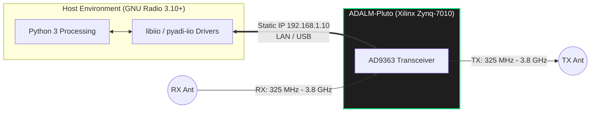

# :material-radio-tower: Software Defined Radio Laboratory Portal

Welcome to the official documentation portal and report repository for **Team-01** in the Software Defined Radio Laboratory course at the Department of Electrical Engineering.

!!! info "Lab Portal Overview"
    This portal hosts all laboratory documentation, including pre-lab preparation, real-time measurement logs, raw `.cf32` data analysis, downloadable PDF reports, and post-session analyses for **ADALM-Pluto SDR** experiments.

## :material-folder-open: Interactive Lab Directory

-   :material-tune:{ .lg .middle } **Lab 00: System Setup & Calibration**

    ---

    Environment calibration, network setup, and initial ADALM-Pluto connectivity.

    Completed & Published

    [:octicons-arrow-right-24: View Logbook](log.md)

-   :material-waveform:{ .lg .middle } **Lab 01: RF Spectrum Monitoring**

    ---

    Wideband spectrum scanning, loopback I/Q analysis, and cellular band identification.

    Published & Recorded

    [:octicons-arrow-right-24: Read Full Report](Lab1/lab01.md)

-   :material-chart-bell-curve-cumulative:{ .lg .middle } **Lab 02: Noise Figure & Nonlinearity**

    ---

    Y-Factor noise figure, $P_{1\text{dB}}$ compression, $\text{IIP}_3$ two-tone testing, and antenna sweep.

    Completed & Published

    [:octicons-arrow-right-24: Pre-Lab](Lab2/prelab.md) · [:octicons-arrow-right-24: Full Report](Lab2/rf-lab02-report.md) · [:material-file-pdf-box: PDF](Lab2/lab02_report.pdf)

-   :material-radio-fm:{ .lg .middle } **Lab 03: FM Radio, Stereo MPX & RDS**

    ---

    Coherent/non-coherent FM demodulation, Bessel carrier nulls, rate chains, and RDS decoding.

    Pre-Lab Published

    [:octicons-arrow-right-24: Read Pre-Lab](Lab3/PreLab3.md) · [:material-file-pdf-box: PDF](Lab3/PreLAB3.pdf)

## :material-chip: Interactive System Architecture

## :material-memory: Hardware & Software Specifications

=== ":material-antenna: ADALM-Pluto Transceiver"

    * **RF Transceiver Chip:** Analog Devices AD9363
    * **SoC Architecture:** Xilinx Zynq-7010 (FPGA + Dual ARM Cortex-A9)
    * **Frequency Coverage:** $325\text{ MHz}$ to $3.8\text{ GHz}$ (default RF tuning range)
    * **Reference Oscillator Accuracy:** $\pm 25\text{ ppm}$ TCXO
    * **Network Configuration:** Static IP `192.168.1.10` via LAN/USB

=== ":material-laptop: Software Infrastructure"

    * **Flowgraph Environment:** GNU Radio Companion 3.10+
    * **Offline Post-Processing:** Python 3 (`NumPy`, `SciPy`, `Matplotlib`)
    * **Hardware Interface Drivers:** `libiio` & `pyadi-iio`
    * **Documentation Engine:** MkDocs Material with MathJax rendering
    * **Source Control & Hosting:** Git & GitHub Pages

## :material-account-group: Course & Team Identity

* **Team Identifier:** Team-01 — Seyedparham Moghaddasi & Amirali Rajaee
* **Instructor:** Dr. Seyed Mohammad Karbasi
* **Teaching Assistants:** Ali Aghaei, Fatemeh Pourhassan, Ali Majlesi
* **Department:** Electrical Engineering